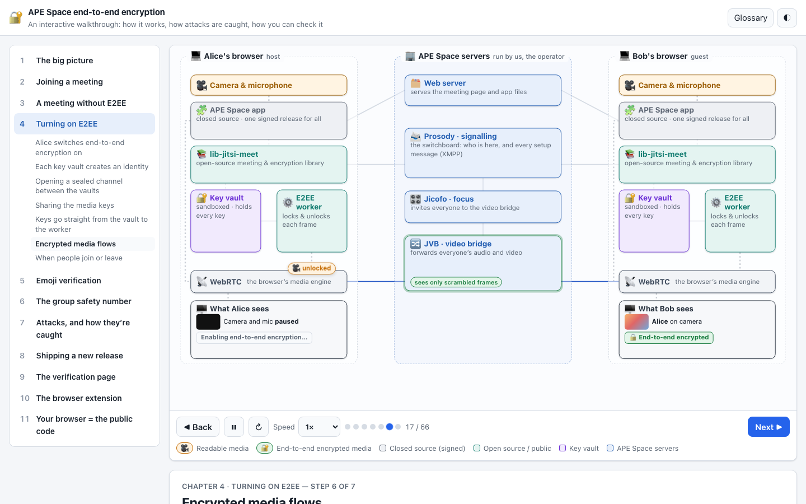

# APESpace code transparency

Public, signed records of the code APESpace's meeting servers run, so anyone can check:

- that the development and production environments serve exactly the same release;
- that this release was built and signed by APESpace's official build;
- that the end-to-end encryption library is open source and can be rebuilt byte-for-byte.

## See how it works: the interactive walkthrough

[](https://hishd.github.io/apespace-public/visual-representation/)

**[Open the walkthrough](https://hishd.github.io/apespace-public/visual-representation/)**. It is an animated, step-by-step explanation that runs in your browser, with nothing to install. It follows two people through a meeting and shows:

- how end-to-end encryption is switched on and how the keys are shared, without the servers ever holding them;
- how a dishonest server's attacks are refused, or show up when participants compare the emoji or the safety number;
- how a release is built, signed and logged, and how anyone can check that the code in their browser is that release.

Each step has a plain explanation, and an "Under the hood" panel for technical reviewers. Its source is in [`visual-representation/`](visual-representation/).

**Check it now:**
- open the [verification page](https://hishd.github.io/apespace-public/), which checks both environments from your browser;
- install the [APESpace Verify extension](extension/), which checks the meeting you are in and lets you inspect its end-to-end encryption;
- or run `node verify/cli.mjs` from a clone of this repository (Node.js 20+).

## What is here

| Path | What it is |
|---|---|
| `releases/<release id>/manifest.json` | SHA-256 and size of every file in the web app of one release. The release id is the SHA-256 of this file. |
| `releases/<release id>/builds/<time>-<branch>-<commit>.json` | A build record: which commit and branch of APESpace's source produced this release, and when. |
| `…json.sigstore.json` | The record's [Sigstore](https://www.sigstore.dev/) signature. |
| `releases/<release id>/builds/<record>.sbom.cdx.json` | The build's software bill of materials (CycloneDX). Its SHA-256 is in the signed record. |
| `e2ee-module/` | How to rebuild the encryption library from Jitsi's public source and our public patches. |
| `e2ee-attacks/` | Scripts that play a malicious server against a real meeting, and checks of key handling, replays, codecs, leaks and the media path. |
| `docs/` | The [customer explainer](docs/customer-explainer.md), "How APESpace proves its meetings are end-to-end encrypted", and our written positions for security reviewers: cryptographic roadmap, re-review policy, build pipeline, device security, and our assessment of the 2023 academic analysis of Jitsi. |
| `extension/` | The APESpace Verify browser extension. `extension/lib/` holds the signature and release checks shared by the extension, the page and the command line; `extension/config.json` the sites and trust anchors. |
| `verify/` | The environment check used by the verification page and the command line. |
| `index.html` | The verification page. |

Records are added by APESpace's build pipeline and never rewritten: the main branch does not allow force pushes or deletion, and every signature is also logged in Sigstore's public, append-only log (Rekor).

## How releases are signed

The build pipeline builds the web app reproducibly (the same source always gives byte-identical files), fingerprints every file, and signs a build record with Sigstore keyless signing. The signing certificate is issued to the build workflow itself:

```
https://github.com/OFF-GRID-APPS/APESpace-Jitsi-Meet-WebApp/.github/workflows/build-docker-image.yml@refs/heads/<branch>
```

and the signature is recorded in Rekor. No one, including APESpace, can produce a valid record for this identity outside that workflow, or remove one from the log.

APESpace's source moved to this repository on 3 November 2026. Earlier records were signed by the workflow of its previous repository, `Advantage-Group/APESpace-Jitsi-Meet`. They stay here unchanged, but the checks no longer accept that identity, so they show as "not the official build".

Verify a record with Sigstore's own tool:

```sh
cosign verify-blob \
  --bundle releases/<release>/builds/<record>.json.sigstore.json \
  --certificate-identity-regexp '^https://github\.com/OFF-GRID-APPS/APESpace-Jitsi-Meet-WebApp/\.github/workflows/build-docker-image\.yml@refs/heads/(develop|main|master)$' \
  --certificate-oidc-issuer https://token.actions.githubusercontent.com \
  releases/<release>/builds/<record>.json
```

Then check the manifest belongs to the release: `sha256sum releases/<release>/manifest.json` must print the release id.

## What a successful check proves, and what it does not

- Each environment served you exactly the files of a signed release, and both served the same one.
- The meeting page (`index.html`) and the pages under `/static` are compared too, for releases whose pages are static files (they contain `static/load-config.js`). Those pages carry a Content Security Policy that lets only the release's own scripts run, and they read the deployment's `config.js` and `interface_config.js` as data, without running them in the page. In earlier releases each server assembled the pages, so they are not compared.
- `config.js` and `interface_config.js` are generated by each server for its own deployment (addresses, settings), so they are not compared. The settings that decide how end-to-end encryption works are fixed in the release and can't be changed by them.
- The APESpace app itself is not open source: the check proves every environment runs the same signed code, not what that code does. The encryption library is the part you can rebuild and read.
- The check covers what the servers served to you when you checked.
