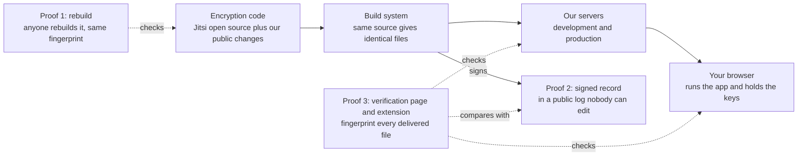

# How APESpace proves its meetings are end-to-end encrypted

16 November 2026

## In short

When end-to-end encryption is on, only the people in your meeting can see and hear it. APESpace, the company running the servers, cannot. You don't have to take our word for it: every part of that claim can be checked.

That promise rests on two conditions, and we state them up front:

- **Your browser is running our published, signed release.** You can check this with our browser extension (below).
- **For sensitive meetings, participants compare the safety number or the emoji.** This is what catches anyone trying to sit in the middle of the encryption.

We make four promises:

1. **Your meeting is encrypted end to end.** Audio and video are locked on your device and unlocked only on the other participants' devices.
2. **Only participants can unlock it.** The keys are created on participants' devices and never sent to our servers.
3. **An attempt to intercept the keys can't go unnoticed.** Keys are exchanged over signed, private channels between participants. An attempt to sit in the middle makes the safety number or the emoji differ, as long as participants compare them.
4. **We, the operator, can't access your media.** Our servers only pass along scrambled data they can't read.

We back these promises with three proofs anyone can check:

- **The encryption code is public.** You can read it and rebuild it yourself, including every change we made to it.
- **Every release is signed and publicly logged.** Each version we deploy is recorded in a public log that we can't rewrite.
- **You can check the code your browser receives.** Our verification page and browser extension compare it with the signed release.

The app travels from public code, through our build system and servers, to your browser. Each step is covered by a proof you can check yourself.

## What end-to-end encryption means in a meeting

All APESpace meetings are encrypted on the way to and from our servers. With end-to-end encryption on, there is a second lock: the servers can't open it.

|  | Standard meeting | End-to-end encrypted meeting |
| --- | --- | --- |
| Who can see and hear the meeting | Participants, and in principle the server | Participants only |
| Where audio and video are unlocked | On the server and on each device | On each participant's device only |
| What the server handles | Readable media it forwards | Scrambled media it forwards but can't read |
| AI recorder | Available | Blocked, because it would send readable audio to a server |
| Server recording, live streaming, transcription | Available where enabled | Blocked, and stopped if encryption is turned on |
| Local recording in your own browser | Available | Available (it never leaves your device) |

**How to turn it on:** the host opens **Security options** (the shield icon) and switches on **End-to-End Encryption**. While encryption is starting, your camera and microphone are paused and the button shows "Enabling end-to-end encryption…". Nothing is sent until encryption is ready. If it can't start within 30 seconds, media stays paused rather than being sent unencrypted.

When it is on, a green lock label appears in the meeting. Everyone needs a browser that supports encrypted media streams: a recent Chrome or Edge, or the APESpace app. We are still confirming Firefox and Safari. A browser or app that can't encrypt leaves an encrypted meeting as soon as it joins, and says why, so its audio and video never reach our servers unencrypted. APESpace has no phone dial-in.

Only the host can switch encryption off. If the host does, everyone sees a warning that stays on screen until they close it.

## How keys are shared, and why they can't be hijacked

The keys that lock your audio and video are made on your device and travel only inside private, signed channels between participants. The server carries those channels but can't open them.

1. **Each device makes its own key.** When encryption starts, your browser creates a random media key. It never leaves your device unprotected.
2. **Each pair of participants opens a private channel.** Your browser and every other participant's browser set up a one-to-one encrypted channel (the Olm protocol, also used by the Matrix messenger). Each browser signs its side with its own identity key.
3. **Keys travel only inside those channels.** Your media key is sent to each participant through your private channel with them. The server forwards these messages but sees only scrambled data.
4. **Keys change when people join and leave.**
   - **When someone joins,** every participant moves its key one step forward with a one-way function before the newcomer gets it. A newcomer therefore can't unlock anything said before they joined.
   - **When someone leaves,** the remaining participants switch to new keys about five seconds later, so a person who has left can't listen in afterwards.
5. **Old or repeated media is rejected.** Each piece of encrypted media carries a counter. A participant's app plays each piece only once, so a server can't replay earlier audio or video.

**The safety number.** Everyone in the meeting can confirm at once that nobody is sitting in the middle. The host chooses **Compare safety number** in Security options, and every participant sees the same 12-digit number. Read it aloud: if everyone has the same number, the encryption between all of you is genuine. If someone is in the middle, the numbers differ.

**Emoji verification.** Any two participants can also confirm that nobody is sitting between them. Open the participant's menu, choose **Verify participant**, and both of you see a short row of emoji. Compare them by voice or on camera:

- **They match:** your channel is genuine, and APESpace shows "verified".
- **They don't match**, or the keys behind them don't check out: someone may be intercepting the encryption. The lock label turns red and names the participant. Don't share anything sensitive.

The emoji are calculated from the secret your two browsers share. Someone in the middle would hold two different secrets, so the two of you would see different emoji.

## Why we can't see or hear your meeting

Our servers never hold the keys, so the media passing through them is unreadable to us.

- **The keys never reach us.** They are created on participants' devices and exchanged only inside the private channels described above.
- **The server just forwards.** The video bridge sends each participant's scrambled media on to the others without unlocking it.
- **Nothing is sent unlocked while encryption starts.** Cameras and microphones stay paused until encryption is ready.
- **Features that would need readable audio are switched off.** The AI recorder, server recording, live streaming and transcription are blocked while end-to-end encryption is on, and they stop if encryption is turned on during a meeting.
- **Hidden participants get no keys.** The app refuses to share keys with anyone who isn't shown in the participant list, so a server can't add an invisible listener.

There is one catch, and it is the reason for the rest of this document. The meeting app runs in your browser, and our servers deliver it. A dishonest operator could in principle send a changed app that leaks the keys. The next three sections show how you can check that this hasn't happened.

## Proof 1: the encryption code is public, and you can rebuild it

The part of APESpace that encrypts your meeting is Jitsi's open-source library, lib-jitsi-meet, with eight public changes. Two come from Jitsi itself. Six are ours: hidden participants get no keys, the safety number, a protected key store in your browser, newcomers can't read earlier media, replays are rejected, and encrypted video always uses one format. Anyone can rebuild the library with these changes and get exactly the files our servers deliver.

|  |  |
| --- | --- |
| File your browser loads | `/libs/lib-jitsi-meet.min.js` |
| Its fingerprint (SHA-256) | `686d5d759c1a7173736de95cf83fd61ca9fc2abcaedd39ba36e1bd8c8ee0a20c` (its worker, key store and Olm files have published fingerprints too) |
| Source | [jitsi/lib-jitsi-meet](https://github.com/jitsi/lib-jitsi-meet) version 2118.0.0, plus the eight public changes in [e2ee-module](https://github.com/hishd/apespace-public/tree/main/e2ee-module) |
| Rebuild instructions | [e2ee-module](https://github.com/hishd/apespace-public/tree/main/e2ee-module) in our public transparency repository |

A fingerprint is a short code calculated from a file's contents. Change a single byte and the fingerprint changes completely. If your rebuilt file has the same fingerprint as the one we deliver, the two files are identical.

To rebuild it, install Git and Docker, then run `./build.sh` in the `e2ee-module` folder. The script downloads Jitsi's public code, applies the changes, builds it, and prints the fingerprints. Security reviewers can then read the encryption logic itself in the `modules/e2ee/` folder of lib-jitsi-meet.

## Proof 2: every release is signed and publicly logged

Each version of the APESpace app we deploy has a public record. The record lists the fingerprint of every file, and it is signed by our automated build system and entered in a public log that no one can edit.

1. **The build is reproducible.** The same source code always produces byte-identical files, so a release has one exact set of fingerprints.
2. **Every file is fingerprinted.** The build lists every file in the app with its fingerprint. The fingerprint of that list becomes the release ID.
3. **The build system signs the record.** We use [Sigstore](https://www.sigstore.dev/), a free public signing service run by the Linux Foundation's Open Source Security Foundation. The signature is tied to our build workflow on GitHub, not to a person, so nobody can sign a record from a laptop, not even us.
4. **The signature goes into a public log.** Sigstore writes every signature into Rekor, its public append-only log. Entries can't be changed or removed, so a release can't be quietly replaced later.
5. **The record is published.** It goes into our [public transparency repository](https://github.com/hishd/apespace-public) under `releases/<release ID>/`. That repository blocks rewriting history.

The result: if we ever served code that wasn't built and signed this way, it couldn't match any signed record. If we did build and sign something different, it would show up permanently in the public log.

You can check a record with Sigstore's own `cosign` tool, without trusting our page or extension. The exact command is in the [repository README](https://github.com/hishd/apespace-public#how-releases-are-signed).

## Proof 3: the verification page checks what our servers actually deliver

Our [verification page](https://hishd.github.io/apespace-public/) downloads the app straight from our servers and checks it against the signed release, in your own browser. Press **Verify now**. The page checks both our development and production environments, and for each one it:

1. Downloads every script, stylesheet and data file of the app from that server.
2. Calculates each file's fingerprint in your browser.
3. Finds the release those files belong to and confirms the Sigstore signature, the build-system identity and the public log entry. All of this is done in your browser, not on our servers.
4. Compares every file's fingerprint with the signed record.
5. Checks that the encryption library matches the publicly rebuildable fingerprint from Proof 1.

If everything matches, the page shows **"Verified: development and production run the same signed release"**.

**Current state, 16 November 2026.** Development runs the latest signed release: all 323 files identical, and the encryption library matches the public rebuild. Production doesn't run it yet. It still runs an earlier version of the app, which isn't one of the signed releases and doesn't have the protections described in this document, so the page reports production as not verified. We plan to update production by 29 November 2026. We publish this rather than hide it: the page shows the state at the moment you check.

Why development matters: you can test the encryption on our development environment as thoroughly as you like, for example with the extension's Inspector below. Once the page shows that production serves byte-for-byte the same code, what you tested is what runs in production.

The page itself is a plain static page with no backend. Its code is in the same public repository. If you prefer the command line, run `node verify/cli.mjs` from a copy of the repository for the same check.

## Check your own meeting with the APESpace Verify extension

The verification page checks what our servers deliver in general. The APESpace Verify browser extension checks the meeting **you** are in, so it would notice even code sent to you alone. Its source is public, and you install it from that source, so you can read every line.

**Install it (Chrome, Edge or Brave):**

1. Download the [transparency repository](https://github.com/hishd/apespace-public) (**Code → Download ZIP**) and unzip it.
2. Open `chrome://extensions` and turn on **Developer mode**.
3. Click **Load unpacked** and choose the `extension` folder.
4. Pin **APESpace Verify** to the toolbar.

**Code check (always on).** When you open an APESpace meeting, the extension fingerprints every script, stylesheet and WebAssembly module the meeting loads, including the meeting page itself and those in embedded meetings, and compares them with the signed release. The toolbar icon shows:

| Icon | Meaning |
| --- | --- |
| ✓ | Every file this meeting loaded matches a signed release |
| ! | A file differs or isn't part of a signed release. Click the icon to see which. |
| … | Still checking |

**E2EE Inspector (off by default, for test meetings).** Switch on **Inspector mode** in the extension, then join a meeting. Everyone in the meeting is told, and an orange panel shows that recording is on. The Inspector lets you see the encryption with your own eyes:

- the audio and video your browser received, unreadable before decryption and readable with the participants' keys;
- the media keys your browser received, and every key-exchange message the server passed along;
- a search of everything your browser sends out (server messages, data channels and web requests) for the media keys, which shows that no key leaves your browser;
- compared with another participant's capture: proof that each of you holds the other's genuine identity key, so nobody sat in the middle.

**Privacy.** The extension sends nothing anywhere. It downloads only the meeting's own files and our public signed records. Captures stay in your browser unless you save them. A capture contains that meeting's keys, so use test meetings and delete captures when you're done.

## What this does and doesn't prove

We would rather be precise than impressive. These are the limits.

| Topic | What is proven | What is not covered |
| --- | --- | --- |
| Audio, video and screen sharing | Encrypted end to end when the setting is on |  |
| Chat, polls, reactions, shared files, names and meeting details |  | Not end-to-end encrypted. The server sees chat and private messages, polls, reactions, shared files, display names, who joins and when, and the meeting name. |
| Patterns in the traffic | The servers can't hear what is said or see what is shown | The servers can see who is speaking and when, and how much the video changes, from the size and timing of the encrypted traffic |
| Encryption library | Public, rebuildable, byte-for-byte identical to what we serve |  |
| Rest of the APESpace app | Every environment runs the same signed, logged code | Its source isn't public, so you can check that it doesn't leak keys (Inspector), but you can't read it |
| Meeting page and settings files | The meeting page is a static, signed file, checked with the rest | Two settings files are generated by each server for its own setup, so they aren't compared. The settings that decide how encryption works are fixed in the release and can't be changed by them. |
| Code sent to one person | The extension checks the meeting you are in, file by file | Without the extension, you can't tell if a dishonest operator sent altered code to you alone. For sensitive meetings, use the extension. |
| Timing | What the servers delivered when you checked | Other times. The extension checks every meeting you join. |
| Person-in-the-middle attacks | Blocked by signed keys; any remaining attempt makes the safety number or the emoji differ | Only if you compare. Your app doesn't remember people's keys between meetings, so compare in every sensitive meeting. |
| Someone who has just left | They can't read anything said once the keys change | The keys change about five seconds after someone leaves. Until then, what is said can still be read with the old key. |
| The far future | Today's computers can't break the encryption | Someone who records a meeting's traffic today might decrypt it with a large quantum computer in the future. We publish a plan for this. |
| Participants' devices |  | Encryption can't protect against malware on a participant's device, or a participant who records the meeting |

The checks also rely on GitHub and Sigstore working as designed. Both are widely used public services, and the Sigstore log can be audited by anyone.

## Questions and answers

**Do I have to do anything for my meeting to be encrypted?** The host turns on end-to-end encryption in Security options. Checking it with the page or extension is optional.

**What is the quickest check?** Install the APESpace Verify extension and join your meeting. A ✓ on the icon means you are running the signed release. For sensitive meetings, also compare the safety number.

**Can I see which code my meeting runs without the extension?** Yes: Security options shows the fingerprints of the meeting's code, with a link to the page that shows which signed release they belong to. That makes comparing easy, but it is shown by the code itself, so it isn't proof. The extension checks independently.

**Couldn't APESpace just publish fake records?** Records can only be signed by our build workflow, and every signature is permanently entered in Sigstore's public log. A fake or replaced release would either fail the check or leave a permanent public trace.

**Why not publish the whole app's source?** Most of the app is our product. The part that does the encryption is fully public. For the rest, we prove it is the same signed code everywhere, and the Inspector lets you watch that the keys never leave your browser.

**How long does APESpace keep meeting details?** Meeting details and participants' email addresses are deleted within about a day of a meeting's access ending, and disappear from our database backups within 7 days after that. Server logs, with display names and IP addresses, are kept for at most 3 days. We never have the audio or video of an encrypted meeting.

**What happens if a check fails?** The extension icon shows **!** and names the file that differs. The page lists the files that differ. Please tell us, and don't hold sensitive meetings until the cause is clear.

## Glossary

| Term | Meaning |
| --- | --- |
| End-to-end encryption (E2EE) | Data is locked on the sender's device and unlocked only on the receivers' devices |
| Fingerprint (SHA-256) | A 64-character code calculated from a file. Any change to the file changes it. |
| Release ID | The fingerprint of the list of every file's fingerprint in one version of the app |
| Sigstore | A free, public service for signing software, run by the Open Source Security Foundation |
| Rekor | Sigstore's public log. Entries can be added but never changed or removed. |
| Olm | The protocol that sets up private one-to-one channels for sharing keys |
| Emoji verification | A comparison of emoji between two participants that shows nobody is in the middle |
| Safety number | One 12-digit number for the whole meeting. If everyone reads the same number, nobody is in the middle. |
| Reproducible build | A build where the same source always produces identical files |

## Links

- [Verification page](https://hishd.github.io/apespace-public/)
- [Public transparency repository](https://github.com/hishd/apespace-public): signed records, extension, rebuild instructions
- [Sigstore](https://www.sigstore.dev/) and its [log search](https://search.sigstore.dev/)
- [Jitsi's lib-jitsi-meet](https://github.com/jitsi/lib-jitsi-meet)
